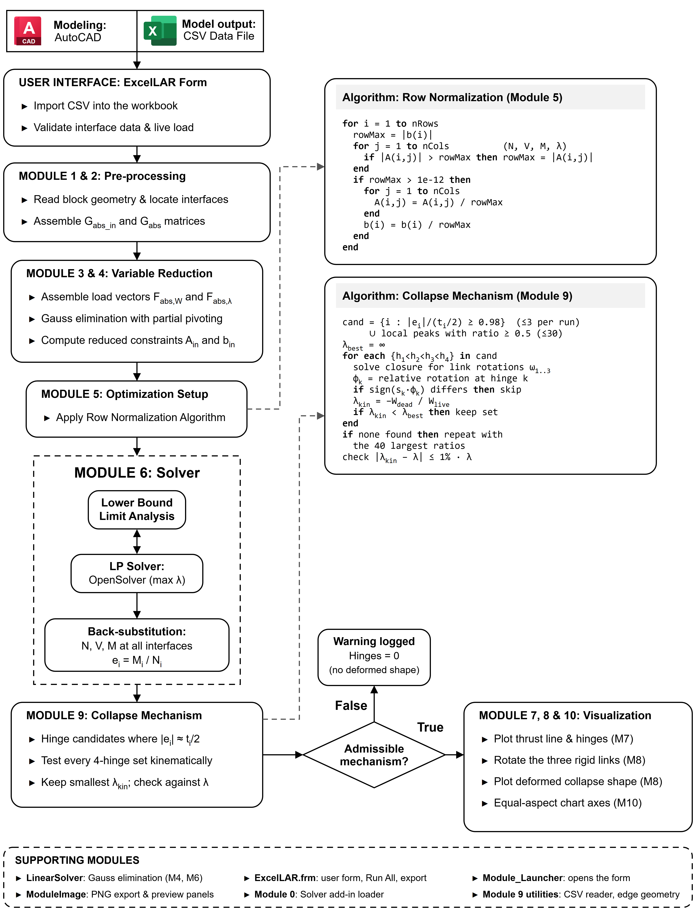
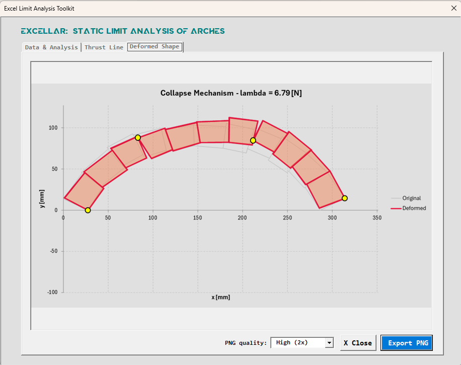

# ExcelLAR: Static Limit Analysis of Arches

ExcelLAR is a Microsoft Excel add-in for the static (lower-bound) limit analysis of 2D masonry arches. It formulates the equilibrium conditions of a rigid-block arch as a linear programming problem and solves it directly in the spreadsheet. ExcelLAR computes the collapse load multiplier (λ), plots the thrust line, and identifies the collapse mechanism with its hinge locations.

The workflow has two parts:

1. An AutoLISP script (`ExcelLAR.lsp`) extracts the block geometry from an AutoCAD drawing and writes it to a CSV file.
2. The Excel add-in (`ExcelLAR.xlam`) imports the CSV file, runs the analysis, and displays the results.



*ExcelLAR workflow and module structure.*

## Repository Structure

```
ExcelLAR/
├── src/
│   ├── ExcelLAR.xlam     Excel add-in (the file you install)
│   ├── ExcelLAR.lsp      AutoLISP geometry exporter for AutoCAD
│   └── vba/              Exported VBA source code (modules and user form)
├── examples/             Sample CSV input files and benchmarks
├── docs/figures/         Figures used in this README
├── LICENSE
└── README.md
```

## Prerequisites

ExcelLAR requires Microsoft Excel for Windows with two solvers installed: the built-in Excel Solver and OpenSolver.

1. In Excel, go to **File** > **Options** > **Add-ins**.
2. Choose **Excel Add-ins** in the **Manage** list and click **Go**.
3. Check **Solver Add-in** and click **OK**.
4. Download the latest version of OpenSolver from https://opensolver.org.
5. Extract the ZIP file to a permanent folder on your computer.
6. Return to the Add-ins dialog (steps 1 and 2) and click **Browse**.
7. Select the extracted `OpenSolver.xlam` file. Make sure both **Solver Add-in** and **OpenSolver** are checked.


*Figure 1: Excel Options menu showing the active add-ins.*


*Figure 2: Both Solver Add-in and OpenSolver must be checked.*


*Figure 3: After a successful installation, both tools appear on the Data ribbon.*

## Installing ExcelLAR

1. Download `src/ExcelLAR.xlam` from this repository and save it in a permanent folder.
2. Right-click the downloaded file, choose **Properties**, check **Unblock** (if shown), and click **OK**. Windows blocks macros in files downloaded from the internet until you do this.
3. In Excel, go to **File** > **Options** > **Add-ins**, choose **Excel Add-ins** in the **Manage** list, and click **Go**.
4. Click **Browse**, select `ExcelLAR.xlam`, and click **OK**. Make sure **ExcelLAR** is checked in the list.

The add-in now loads every time Excel starts. Press **Ctrl+Shift+A** in any workbook to open ExcelLAR.

## Step 1: Geometry Extraction in AutoCAD

Generate the geometry file with the AutoLISP script before opening Excel.

1. Open your 2D masonry arch model in AutoCAD.
2. Make sure every block and backfill element is drawn as a closed `LWPOLYLINE` or `POLYLINE`.
3. Type `APPLOAD` in the command line and load `src/ExcelLAR.lsp`.
4. Type `ExcelLAR` to start the export routine.
5. Click the center point of the arch.
6. Click a point on the edge of the left ground abutment.
7. Click a point on the edge of the right ground abutment.
8. Select all block polylines.
9. If the model includes backfill, answer **Yes** and select the backfill polylines.
10. Enter the block depth (mm) and specific weight (kg/m³), and the backfill properties if applicable.
11. To apply external forces, enter the indices of the loaded blocks (for example `1,3,5`). Press **Enter** for none.
12. Define each force vector by typing its components or by drawing it on screen.
13. Save the resulting CSV file.

Ready-to-use CSV files are available in the `examples/` folder if you want to try ExcelLAR without AutoCAD.

## Step 2: Limit Analysis in Excel

1. Open Excel and press **Ctrl+Shift+A** to open the ExcelLAR window.
2. Click **Import CSV File** and select the file generated by the AutoLISP script (or one from `examples/`).
3. Select the imported data sheet from the drop-down list.
4. Click **Run Analysis** to compute the collapse load multiplier.
5. Open the **Thrust Line** and **Deformed Shape** tabs to view the results.
6. Choose a **PNG quality** and click **Export PNG** to save a plot as an image.


*Figure 4: The ExcelLAR window for data import and analysis.*


*Figure 5: Thrust line inside the masonry blocks, with the hinge locations marked.*



*Figure 6: Collapse mechanism, showing the deformed shape over the original geometry and the hinge locations.*

## Developer Access

The full VBA source code is in `src/vba/`. To view or modify it inside Excel, press **Alt+F11** to open the Visual Basic Editor and expand the project for `ExcelLAR.xlam`. To rebuild the add-in from the exported files, import the `.bas` modules and `ExcelLAR.frm` (with its `ExcelLAR.frx` file next to it) into a new workbook and save it as an Excel Add-in (`.xlam`).

## Troubleshooting

If ExcelLAR does not run, check the following:

* **Macro security:** Go to **File** > **Options** > **Trust Center** > **Trust Center Settings** > **Macro Settings**. Select **Enable VBA macros** and check **Trust access to the VBA project object model**. ExcelLAR needs this access to connect to the Solver add-in.
* **Trusted Locations:** If OpenSolver fails to run, add its folder (and the folder containing `ExcelLAR.xlam`) to **Trust Center Settings** > **Trusted Locations**.
* **Blocked file:** If the add-in loads but macros are disabled, unblock `ExcelLAR.xlam` as described in [Installing ExcelLAR](#installing-excellar).
* **Solver Add-in:** Make sure the built-in Excel Solver is checked in the Add-ins dialog.
* **OpenSolver:** Make sure OpenSolver is loaded. It is required for models with many blocks.
* **Data format:** Use the CSV file exactly as generated by the AutoLISP script. Do not edit the column headers.


*Figure 7: Required macro settings in the Excel Trust Center.*


*Figure 8: Adding the OpenSolver folder to Trusted Locations prevents blocked execution.*

## License

This project is licensed under the terms in the [LICENSE](LICENSE) file.
