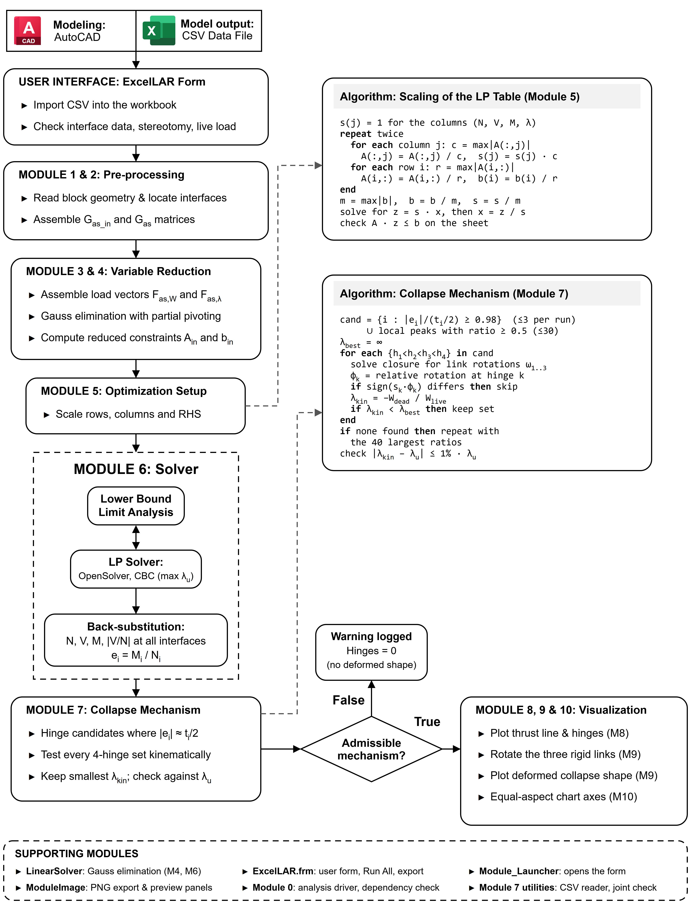
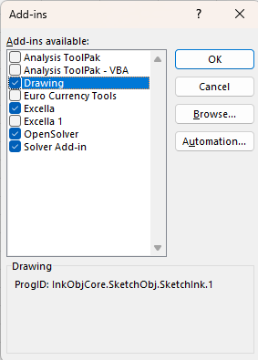
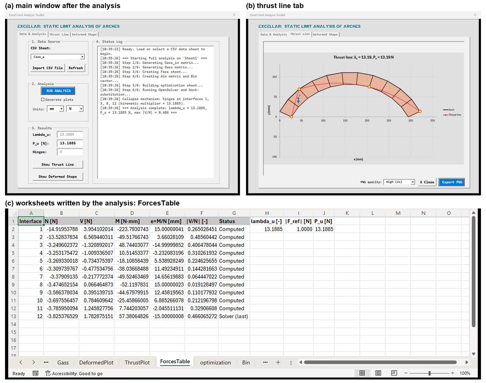

# ExcelLAR: Static Limit Analysis of Arches

ExcelLAR is a Microsoft Excel add-in for the static (lower-bound) limit analysis of 2D masonry arches under Heyman's hypotheses. It writes the equilibrium and admissibility conditions of a rigid-block arch as a linear program, solves it inside the spreadsheet, and returns the collapse multiplier, the collapse force, the thrust line and the four-hinge mechanism. Every intermediate matrix stays on an unprotected worksheet.

The workflow has two parts. An AutoLISP routine (`src/ExcelLAR.lsp`) extracts the block geometry from an AutoCAD drawing and writes a CSV file. The add-in (`src/ExcelLAR.xlam`) imports that file and runs the analysis. A CSV file written by hand or by another program works just as well, so CAD is optional.

*ExcelLAR workflow and module structure.*

## Requirements and tested configuration

ExcelLAR needs Microsoft Excel for Windows and OpenSolver. The Excel Solver add-in is not required since version 1.1. AutoCAD is needed only to export geometry.

| Component | Tested version |
|---|---|
| Operating system | Windows 11 (64-bit) |
| Excel | Microsoft 365, version 16.0 build 17928, 64-bit |
| OpenSolver | 2.9.4, CBC solver |
| AutoCAD | AutoCAD 2026 |

Excel for Mac is not supported, because the plots use Windows libraries. The code is written for 32-bit and 64-bit Excel, but only 64-bit Excel has been tested. Other CAD programs that run AutoLISP and Visual LISP (ActiveX) functions, such as BricsCAD or ZWCAD, may run the routine but have not been tested. If yours does not, use the CSV route described below.

## Installation

No macro or Trust Center setting has to be lowered, and "Trust access to the VBA project object model" is not needed.

1. Download `OpenSolver` from https://opensolver.org.
2. Right-click the ZIP file, choose **Properties**, tick **Unblock**, click **OK**, and extract it to a permanent folder.
3. Download `src/ExcelLAR.xlam` and save it in a permanent folder.
4. Right-click the file, choose **Properties**, tick **Unblock**, and click **OK**. Windows marks downloaded files, and Excel blocks their macros until this is done.
5. In Excel, go to **File** > **Options** > **Add-ins**, choose **Excel Add-ins** in the **Manage** list, and click **Go**.
6. Click **Browse**, select `OpenSolver.xlam`, and click **OK**. Repeat for `ExcelLAR.xlam`. Both must be ticked in the list.

Press **Ctrl+Shift+A** in any workbook to open ExcelLAR. If OpenSolver is missing, the window says what to do.

To check the download, compare the SHA-256 of the add-in with `SHA256SUMS.txt`. In PowerShell: `Get-FileHash ExcelLAR.xlam -Algorithm SHA256`.

*Add-ins dialog. Since version 1.1 the Solver Add-in line may stay unticked.*

## Tutorial with the files of the paper

The steps below reproduce case study a of the paper. The table lists every example, so the same steps reproduce the others.

| Paper | File in `examples/` | Loaded block | Expected λu | Hinge interfaces |
|---|---|---|---|---|
| Benchmark 1 | `BenchMark_CircleArch.csv` | 11 | 1259.81 (4.45 × block weight) | 1, 5, 11, 15 |
| Benchmark 2 | `BenchMark 2_CircleArch.csv` | 11 | 704.86 (2.49 × block weight) | 1, 5, 11, 16 |
| Case a | `11BlocksArch.csv` | 2 | 13.19 | 1, 3, 8, 12 |
| Case a, load moved | `11BlocksArch_LoadBlock3.csv` | 3 | 8.01 | 1, 4, 8, 12 |
| Case b | `55BlocksArch.csv` | 8 and 9 | 12.16 | 1, 10, 34, 56 |
| Case c | `ImperfectionRole_LoadBlock2.csv` | 2 | 11.17 | 1, 3, 8, 12 |
| Case c, load moved | `ImperfectionRole.csv` | 3 | 6.79 | 1, 4, 8, 12 |
| Case d | `11BlocksArch_Backfill.csv` | 2 | 19.01 | 1, 3, 7, 12 |

In these files |F_ref| = 1 N, so Pu in newtons equals λu. The refinement series of case b is in `examples/convergence/`. `Minimal_5Blocks.csv` is a small file with rounded numbers, useful as a template for writing data by hand. `results/` holds the macro-free workbooks of all these analyses, with every intermediate sheet.

### Step 1: geometry in AutoCAD (optional)

Skip this step if you start from a CSV file.

1. Open `examples/cad/11BlocksArch.dwg`. Every block must be a closed `LWPOLYLINE` or `POLYLINE`.
2. Type `APPLOAD` and load `src/ExcelLAR.lsp`. If AutoCAD asks, choose **Load Once**.
3. Type `ExcelLAR`.
4. Click the center point of the arch, then a point on the left abutment edge, then a point on the right abutment edge.
5. Select all the block polylines. Answer **No** to the backfill question (or **Yes**, and select the backfill polylines).
6. Choose the units: **Mm** (drawing in mm, density in kg/m³, forces in N) or **Metre** (drawing in m, specific weight in kN/m³, forces in kN).
7. Enter the depth, here 50 mm, and the density, here 842 kg/m³.
8. Enter the loaded block number, here `2`. Define the force by typing its components, here `0,-1,0`, or by drawing it.
9. Save the CSV file.

### Step 2: analysis in Excel

1. Open an empty workbook and press **Ctrl+Shift+A**.
2. In **1. Data Source**, click **Import CSV File** and select the file. The units in **2. Analysis** follow its headers. They are labels only, and no conversion is made.
3. In **2. Analysis**, keep **Generate plots** ticked and click **RUN ANALYSIS**.
4. Read the results in **3. Results**. For this example λu = 13.1885, Pu = 13.1885 N, and four hinges are found at interfaces 1, 3, 8 and 12.
5. Open the **Thrust Line** and **Deformed Shape** tabs. Choose a **PNG quality** and click **Export PNG** to save a plot.
6. Inspect the worksheets of the workbook.

*ExcelLAR window after the analysis, thrust line tab, and sheet ForcesTable.*

### Worksheets written by the analysis

| Sheet | Content |
|---|---|
| `Gass_in`, `Gass` | admissibility and equilibrium matrices |
| `Fass` | dead-load and reference live-load vectors |
| `Ain`, `Bin` | reduced constraints in the four variables |
| `optimization` | scaled linear program, with the column factors in row 4 |
| `ForcesTable` | N, V, M, e and \|V/N\| at each interface; λu, \|F_ref\| and Pu |
| `ThrustPlot`, `DeformedPlot` | charts and their data |
| `RunInfo` | versions, results, hinge interfaces, LP residual, run time of each stage |

## CSV input format

One row holds up to three independent records side by side, so the columns can be filled separately. The header row is mandatory, and the unit between brackets in columns B and J sets the labels.

| Column | Header | Content |
|---|---|---|
| A | Block | `Block 1`, `Block 2`, ... numbered from one abutment to the other |
| B, C | X, Y | vertices of the block in sequence, with the first vertex repeated at the end |
| E | Interface | `Interface 1` ... `Interface n+1` for n blocks |
| F | Len | length of the interface (thickness t) |
| G | Ds | distance between consecutive interfaces (information only) |
| H | Fi | angle in degrees of the interface normal, pointing from block j-1 to block j |
| I | Depth | out-of-plane depth (information only) |
| J | Weight | weight of block i, written on row i + 1 |
| L, M | Fx_lam, Fy_lam | components of the reference live load on a row of that block; an empty cell means zero |
| N | Backfill_Added | `Yes` or `No` (information only) |

Consecutive blocks must share two vertices. Internal values of Len and Fi are checked against the geometry and corrected, with the cells highlighted. Live loads act at the block centroid. A load elsewhere on the arch can be represented by statically equivalent forces on two neighbouring blocks, as in `55BlocksArch.csv`. Backfill rows use the label `Backfill 1`, and they are drawn but not analysed: their weight is already included in column J.

## Input checks

Before the solver starts, ExcelLAR checks that consecutive blocks share an edge, that the abutments have a positive length and that a live load exists. Any block shape and joint orientation is accepted. The stereotomy check stops the analysis, with a message naming the blocks, if two blocks overlap, if the two joints of a block touch or a block is twisted, or if two joints cross. A non-convex block produces a warning only.

## Reproducing the validation

`validation/` holds an independent Python implementation of the same linear program (`lbla.py`), the exact four-hinge reference of case study b (`refine.py`, `ref2.py`) and the minimum-thickness study (`minthick.py`). See `validation/README.md`.

## Developer access

The VBA source is in `src/vba/`. Modules 1 to 9 follow the execution order; Module 7 also holds the CSV reader and the input checks. `tools/build_xlam.py` rebuilds the add-in from these files, or import the `.bas` modules and `ExcelLAR.frm` (with `ExcelLAR.frx` next to it) into a new workbook and save it as an Excel Add-in. To run ExcelLAR from a script, open both add-ins and call `ExcelLAR.xlam!RunAnalysisSilent` with the name of the data sheet.

## Troubleshooting

| Symptom | Cause and remedy |
|---|---|
| Macros blocked, or a red "Security Risk" bar | The file still carries the download mark. Close Excel and repeat the **Unblock** step. Alternatively, put it in a Trusted Location folder of your own (**Trust Center Settings** > **Trusted Locations**). Do not enable all macros. |
| "OpenSolver is not loaded" | Install it as in [Installation](#installation), and unblock the ZIP file before extracting it. |
| OpenSolver starts but fails | Its folder must not contain non-English characters. Extract it again to a simple path such as `C:\OpenSolver`. |
| The add-in is not in the list | Use **Browse** and select the file again, and check that it was not left in the Downloads folder or inside the ZIP file. |
| "do not share an edge", "overlap" or "joints touch" | The drawing does not form a chain of blocks: see [Input checks](#input-checks). |
| "infeasible" | No thrust line in equilibrium with the dead loads fits inside the arch. |
| Warning that the kinematic multiplier differs | The static and kinematic results differ by more than 1%. Check the geometry, and report the case if it persists. |

To report a problem, please include the Excel version and build (**File** > **Account** > **About Excel**) and the text of the message.

## How to cite

Please cite the paper describing ExcelLAR in SoftwareX. The code is available in this repository.

## License

This project is licensed under the terms in the [LICENSE](LICENSE) file.
